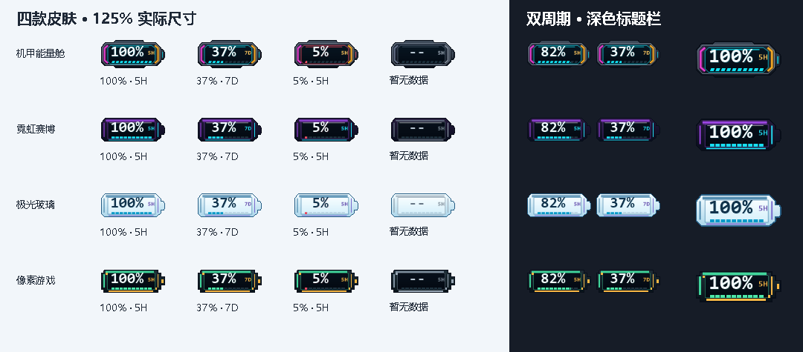

# Codex Usage Battery

一个适用于 Windows 的 Codex 剩余额度悬浮窗。它以电池样式跟随 Codex 桌面窗口，显示真实的 5 小时及每周额度。

> 本项目是独立的第三方工具，与 OpenAI 无官方隶属关系。目前为预览版，已在开发者当前 Windows 环境测试，尚需在更多机器和安装方式下验证。



## 功能

- 每 30 秒通过本地 Codex 客户端查询额度；鼠标悬停查看两种周期、重置时间和倒计时。
- 支持 5H、7D 单独显示或并排显示；点击单周期图标可切换周期。
- 四款皮肤，三种大小，以及静态、柔和、炫酷三档动画。动画不会改变额度或进度条长度。
- 可锁定位置；支持分别为两个周期配置低额度通知，默认只变色、不弹通知。
- 数据不可用时显示 `--`；过期数据会标识状态，不把等待重置的数据伪装成 100%。

## 运行

需要 Windows 10/11、.NET Framework 4.5 或更高版本，以及已安装并登录的 Codex 桌面版。程序还需要能找到本机 `codex.exe`。兼容范围以实际测试为准。

1. 下载并完整解压 Release 中的 Windows ZIP。
2. 双击 `CodexUsageBattery.exe` 或 `Start.cmd`。
3. 激活 Codex 窗口；图标出现后右键可打开设置菜单。
4. 右键选择退出，或运行 `Stop.cmd`。

图标是独立悬浮窗，不修改 Codex 安装包；切换到其他应用或最小化 Codex 时会隐藏，程序仍在运行。程序不会自行设置开机启动。

预览版没有数字签名，Windows 可能显示 SmartScreen 提示。请从可信来源获取程序，不要为了运行它而关闭系统保护。发布包旁的 SHA-256 文件用于核对下载内容是否一致，不能单独证明程序安全。

## 数据与隐私

程序通过本机 Codex `app-server` 查询 `account/rateLimits/read`，使用 Codex 自身的登录状态，不要求在本工具中输入 API 密钥。Codex 客户端仍会按自身逻辑联网；本工具不保存登录令牌或原始账户响应。

本工具在 `%LOCALAPPDATA%\CodexUsageBattery` 保存：

- `settings.json`：皮肤、位置、周期、动画及提醒设置。
- `status.json`：运行状态、窗口信息和最近一次额度。诊断时还可能生成 `probe-result.json`、`last-error.txt`。

这些文件可能包含个人用量或窗口标题，不应提交到公开仓库，也不应附带进发布包。升级同一文件夹中的旧版时，如果新数据目录没有设置，程序会读取旧目录的 `settings.json`；下次修改设置时保存到新位置，旧文件不会被删除。

开发测试可设置 `CODEX_USAGE_BATTERY_DATA_DIR`，将设置和诊断文件写入指定的隔离目录；正式使用通常无需设置。

## 构建与验证

在 64 位 Windows 上，使用系统 .NET Framework C# 编译器和 PowerShell：

```powershell
powershell -NoProfile -File .\build.ps1
.\CodexUsageBattery.exe --core-test
```

`--core-test` 不需要登录 Codex，检查配置迁移、额度解析、通知去重和各皮肤的动画绘制。使用 `Start-Process -Wait -PassThru` 查看 EXE 的退出码；0 表示通过。交互桌面上还可运行 `--self-test` 检查悬浮窗和悬停行为，并在 EXE 所在目录生成示例预览图。`--probe` 会读取当前用量与窗口信息并写入本地数据目录；不要公开其输出。

生成免安装 ZIP 和 SHA-256 文件：

```powershell
powershell -NoProfile -File .\package.ps1
```

产物位于 `dist/`。脚本只将 EXE、启动／关闭脚本、使用说明和许可证打包，不包含本机配置或诊断文件；默认不会覆盖已有同名产物。

## 常见问题

- **图标不出现**：确认 Codex 桌面窗口位于前台，且没有被最小化。右键菜单可恢复默认位置。
- **显示 `--` 或提示无法读取**：检查 Codex 登录、网络和 `codex.exe`。程序先检查本地 Codex 安装目录，再检查 `PATH`。如使用自定义位置，可以将环境变量 `CODEX_USAGE_BATTERY_CLI` 设为该 EXE 的完整路径后启动程序。
- **动画不播放**：静态模式、程序隐藏、数据过期或 Windows 高对比度模式下会停止动画。
- **低额度没有弹通知**：提醒默认关闭，需要在右键菜单里分别开启；系统通知设置也可能影响显示。

## License

[MIT](LICENSE)。Codex 和 OpenAI 的名称属于其各自权利人。
